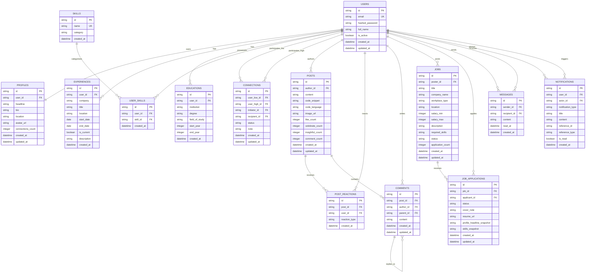

# ProNet - Database Schema Specification & Data Architecture (v1.0.0)

- **Document Version:** 1.0.0
- **Status:** Approved Engineering Contract
- **Author:** Principal Database Architect
- **Target Release:** v1.0 Local Production
- **Approved For Implementation:** Phases 3, 4, 5, 6
- **Storage Engine:** SQLite 3.40+ (WAL Mode) via SQLAlchemy 2.0 / aiosqlite

---

## 1. Executive Summary & Storage Engine Architecture

### 1.1 Architectural Purpose & Scope
This document specifies the authoritative relational schema, data dictionary, integrity constraints, indexing strategies, state lifecycle rules, and deterministic seed fixtures for **ProNet**. Designed to support an enterprise-grade professional network operating with zero cloud externalities, the storage engine guarantees strict sub-millisecond local latency, bi-directional social graph traversal, two-query feed pagination, two-level comment threading, a structured applicant tracking system (Mini-ATS), and real-time messaging guards.

### 1.2 Storage Engine & Concurrency Configuration (SQLite WAL)
ProNet executes against an optimized, local-first SQLite database (`pronet.db`) operating asynchronously via `SQLAlchemy 2.0` and `aiosqlite`. To satisfy all Non-Functional Requirements (**NFR-001**, **NFR-002**, **NFR-007**, **NFR-010**) and mitigate write contention, the database engine enforces the following PRAGMA configuration upon every connection lease:

```sql
PRAGMA journal_mode = WAL;         -- Decouples concurrent readers from writers
PRAGMA synchronous = NORMAL;       -- Balances durability with high-speed local disk I/O
PRAGMA busy_timeout = 5000;        -- Waits up to 5000 ms before returning SQLITE_BUSY
PRAGMA foreign_keys = ON;          -- Strictly enforces relational integrity & cascades
PRAGMA cache_size = -64000;        -- Allocates 64 MB shared page cache in RAM
PRAGMA temp_store = MEMORY;        -- Routes intermediate sorts and CTE tables to RAM
PRAGMA mmap_size = 268435456;      -- 256 MB memory-mapped I/O for lightning reads
```

---

## 2. Entity-Relationship Model (Mermaid.js)

The ProNet schema comprises 14 tightly coupled relational entities designed for 3NF normalization, optimized query execution paths, and zero redundant storage.



---

## 3. Relational Data Dictionary & Table Specifications

### 3.1 Table: `users`
Represents the core identity account record for credential authentication, token issuance, and global user reference.

| Column | Data Type | Nullable | Default | Constraints & Keys | Description |
|---|---|---|---|---|---|
| `id` | `VARCHAR(64)` | No | None | `PRIMARY KEY` | Unique canonical user identifier (e.g., `usr_elena_rostova`). |
| `email` | `VARCHAR(255)` | No | None | `UNIQUE`, `INDEX` | Unique primary login email address (case-insensitive indexed). |
| `hashed_password` | `VARCHAR(255)` | No | None | None | Cryptographic password hash generated via `bcrypt` (work factor 12). |
| `full_name` | `VARCHAR(128)` | No | None | `INDEX` | User's full professional display name. |
| `is_active` | `BOOLEAN` | No | `TRUE` | None | Account operational status flag. |
| `created_at` | `DATETIME` | No | `CURRENT_TIMESTAMP`| None | Account registration timestamp. |
| `updated_at` | `DATETIME` | No | `CURRENT_TIMESTAMP`| None | Account record last modification timestamp. |

### 3.2 Table: `profiles`
Maintains extended professional identity attributes, avatar media pointers, summary bio, and cached social graph metrics.

| Column | Data Type | Nullable | Default | Constraints & Keys | Description |
|---|---|---|---|---|---|
| `id` | `VARCHAR(64)` | No | None | `PRIMARY KEY` | Profile record identifier. |
| `user_id` | `VARCHAR(64)` | No | None | `UNIQUE`, `FOREIGN KEY (users.id) ON DELETE CASCADE` | 1-to-1 foreign key mapping to parent user account. |
| `headline` | `VARCHAR(255)` | No | None | None | Professional headline (e.g., "Staff AI Engineer \| LLM Systems"). |
| `bio` | `TEXT` | Yes | `NULL` | None | Free-form professional summary and narrative biography. |
| `location` | `VARCHAR(128)` | No | None | `INDEX` | Geographic location / primary metropolitan area. |
| `avatar_url` | `VARCHAR(512)` | Yes | `NULL` | None | Local filesystem URI for profile photo (`/uploads/avatars/...`). |
| `connections_count`| `INTEGER` | No | `0` | `CHECK (connections_count >= 0)` | Denormalized count of confirmed 1st-degree connections. |
| `created_at` | `DATETIME` | No | `CURRENT_TIMESTAMP`| None | Record creation timestamp. |
| `updated_at` | `DATETIME` | No | `CURRENT_TIMESTAMP`| None | Record modification timestamp. |

### 3.3 Table: `experiences`
Records a chronological item in the user's professional employment history.

| Column | Data Type | Nullable | Default | Constraints & Keys | Description |
|---|---|---|---|---|---|
| `id` | `VARCHAR(64)` | No | None | `PRIMARY KEY` | Experience entry identifier. |
| `user_id` | `VARCHAR(64)` | No | None | `INDEX`, `FOREIGN KEY (users.id) ON DELETE CASCADE` | Target user account owning this career entry. |
| `company` | `VARCHAR(128)` | No | None | `INDEX` | Employing company or client organization name. |
| `title` | `VARCHAR(128)` | No | None | None | Job title / professional position held. |
| `location` | `VARCHAR(128)` | Yes | `NULL` | None | Office location or remote arrangement. |
| `start_date` | `DATE` | No | None | None | Employment commencement date. |
| `end_date` | `DATE` | Yes | `NULL` | None | Employment conclusion date (`NULL` represents active/current position). |
| `is_current` | `BOOLEAN` | No | `FALSE` | None | Boolean indicator representing current employment. |
| `description` | `TEXT` | Yes | `NULL` | None | Key achievements, responsibilities, and technical stack details. |
| `created_at` | `DATETIME` | No | `CURRENT_TIMESTAMP`| None | Experience record creation timestamp. |

*Table Constraints:*
- `CHECK (end_date IS NULL OR end_date >= start_date)` (Enforces **REQ-003** validation rule).

### 3.4 Table: `educations`
Captures academic credentials, degrees, institutions, and dates of study.

| Column | Data Type | Nullable | Default | Constraints & Keys | Description |
|---|---|---|---|---|---|
| `id` | `VARCHAR(64)` | No | None | `PRIMARY KEY` | Education entry identifier. |
| `user_id` | `VARCHAR(64)` | No | None | `INDEX`, `FOREIGN KEY (users.id) ON DELETE CASCADE` | Target user account owning this education credential. |
| `institution` | `VARCHAR(128)` | No | None | `INDEX` | Academic institution or university name. |
| `degree` | `VARCHAR(128)` | No | None | None | Degree conferred (e.g., "B.S.", "M.S.", "Ph.D."). |
| `field_of_study`| `VARCHAR(128)` | Yes | `NULL` | None | Major or academic discipline (e.g., "Computer Science"). |
| `start_year` | `INTEGER` | No | None | None | Matriculation year. |
| `end_year` | `INTEGER` | Yes | `NULL` | None | Graduation year (`NULL` if in progress). |
| `created_at` | `DATETIME` | No | `CURRENT_TIMESTAMP`| None | Record creation timestamp. |

*Table Constraints:*
- `CHECK (end_year IS NULL OR end_year >= start_year)`

### 3.5 Table: `skills`
Master lookup catalog of canonical technical and professional skills for autocomplete and faceted search.

| Column | Data Type | Nullable | Default | Constraints & Keys | Description |
|---|---|---|---|---|---|
| `id` | `VARCHAR(64)` | No | None | `PRIMARY KEY` | Canonical skill identifier (e.g., `skl_python`). |
| `name` | `VARCHAR(64)` | No | None | `UNIQUE`, `INDEX` | Normalized skill name (case-insensitive unique index). |
| `category` | `VARCHAR(64)` | Yes | `NULL` | `INDEX` | Functional skill cluster (e.g., "Engineering", "Design", "DevOps"). |
| `created_at` | `DATETIME` | No | `CURRENT_TIMESTAMP`| None | Catalog registration timestamp. |

### 3.6 Table: `user_skills`
Many-to-many junction table binding users to their declared skills inventory.

| Column | Data Type | Nullable | Default | Constraints & Keys | Description |
|---|---|---|---|---|---|
| `id` | `VARCHAR(64)` | No | None | `PRIMARY KEY` | Junction entry identifier. |
| `user_id` | `VARCHAR(64)` | No | None | `INDEX`, `FOREIGN KEY (users.id) ON DELETE CASCADE` | Associated user identifier. |
| `skill_id` | `VARCHAR(64)` | No | None | `INDEX`, `FOREIGN KEY (skills.id) ON DELETE CASCADE` | Associated canonical skill identifier. |
| `created_at` | `DATETIME` | No | `CURRENT_TIMESTAMP`| None | Association timestamp. |

*Table Constraints:*
- `UNIQUE (user_id, skill_id)` (Guarantees no duplicate skill tags on a user profile).

### 3.7 Table: `connections`
Maintains the bi-directional social graph edges, request lifecycles, and relational notes.

| Column | Data Type | Nullable | Default | Constraints & Keys | Description |
|---|---|---|---|---|---|
| `id` | `VARCHAR(64)` | No | None | `PRIMARY KEY` | Connection edge identifier. |
| `user_low_id` | `VARCHAR(64)` | No | None | `INDEX`, `FOREIGN KEY (users.id) ON DELETE CASCADE` | Lexicographically lower user ID (`min(u1, u2)`). |
| `user_high_id`| `VARCHAR(64)` | No | None | `INDEX`, `FOREIGN KEY (users.id) ON DELETE CASCADE` | Lexicographically higher user ID (`max(u1, u2)`). |
| `initiator_id`| `VARCHAR(64)` | No | None | `INDEX`, `FOREIGN KEY (users.id) ON DELETE CASCADE` | User ID of the party who originated the connection request. |
| `recipient_id`| `VARCHAR(64)` | No | None | `INDEX`, `FOREIGN KEY (users.id) ON DELETE CASCADE` | User ID of the recipient invited to connect. |
| `status` | `VARCHAR(20)` | No | None | `INDEX` | Edge lifecycle status: `PENDING`, `ACCEPTED`, or `IGNORED`. |
| `note` | `VARCHAR(300)` | Yes | `NULL` | None | Optional personalized greeting message (≤ 300 characters). |
| `created_at` | `DATETIME` | No | `CURRENT_TIMESTAMP`| None | Request origination timestamp. |
| `updated_at` | `DATETIME` | No | `CURRENT_TIMESTAMP`| None | Status transition timestamp. |

*Table Constraints:*
- `CHECK (user_low_id < user_high_id)` (Enforces canonical pair ordering).
- `CHECK (status IN ('PENDING', 'ACCEPTED', 'IGNORED'))`
- `CHECK (initiator_id IN (user_low_id, user_high_id) AND recipient_id IN (user_low_id, user_high_id) AND initiator_id != recipient_id)`
- `UNIQUE (user_low_id, user_high_id)` (Prevents reciprocal duplicate collisions per **EDG-001**).

### 3.8 Table: `posts`
Captures feed broadcast items including rich text, code snippets, syntax metadata, and attached media.

| Column | Data Type | Nullable | Default | Constraints & Keys | Description |
|---|---|---|---|---|---|
| `id` | `VARCHAR(64)` | No | None | `PRIMARY KEY` | Post identifier. |
| `author_id` | `VARCHAR(64)` | No | None | `INDEX`, `FOREIGN KEY (users.id) ON DELETE CASCADE` | User identifier of the post author. |
| `content` | `TEXT` | No | None | None | Primary post body text (≤ 3000 characters, sanitized HTML/Markdown). |
| `code_snippet`| `TEXT` | Yes | `NULL` | None | Embedded source code snippet text. |
| `code_language`|`VARCHAR(32)` | Yes | `NULL` | None | Syntax highlighting tag (e.g., `python`, `typescript`, `sql`). |
| `image_url` | `VARCHAR(512)` | Yes | `NULL` | None | Local filesystem media URI (`/uploads/posts/...`). |
| `like_count` | `INTEGER` | No | `0` | `CHECK (like_count >= 0)` | Denormalized count of active `LIKE` reactions. |
| `celebrate_count`|`INTEGER`| No | `0` | `CHECK (celebrate_count >= 0)` | Denormalized count of active `CELEBRATE` reactions. |
| `insightful_count`|`INTEGER`|No | `0` | `CHECK (insightful_count >= 0)`| Denormalized count of active `INSIGHTFUL` reactions. |
| `comment_count`| `INTEGER` | No | `0` | `CHECK (comment_count >= 0)` | Denormalized count of all Level 1 and Level 2 comments. |
| `created_at` | `DATETIME` | No | `CURRENT_TIMESTAMP`| `INDEX` | Post publication timestamp. |
| `updated_at` | `DATETIME` | No | `CURRENT_TIMESTAMP`| None | Post modification timestamp. |

### 3.9 Table: `post_reactions`
Maintains individual user emotional reactions to feed posts.

| Column | Data Type | Nullable | Default | Constraints & Keys | Description |
|---|---|---|---|---|---|
| `id` | `VARCHAR(64)` | No | None | `PRIMARY KEY` | Reaction entry identifier. |
| `post_id` | `VARCHAR(64)` | No | None | `INDEX`, `FOREIGN KEY (posts.id) ON DELETE CASCADE` | Post receiving the reaction. |
| `user_id` | `VARCHAR(64)` | No | None | `INDEX`, `FOREIGN KEY (users.id) ON DELETE CASCADE` | User submitting the reaction. |
| `reaction_type`|`VARCHAR(20)` | No | None | `INDEX` | Reaction category: `LIKE`, `CELEBRATE`, `INSIGHTFUL`. |
| `created_at` | `DATETIME` | No | `CURRENT_TIMESTAMP`| None | Reaction creation timestamp. |

*Table Constraints:*
- `CHECK (reaction_type IN ('LIKE', 'CELEBRATE', 'INSIGHTFUL'))`
- `UNIQUE (post_id, user_id)` (Strictly enforces exactly 1 reaction per user per post per **REQ-011**).

### 3.10 Table: `comments`
Implements two-level threaded conversations beneath posts.

| Column | Data Type | Nullable | Default | Constraints & Keys | Description |
|---|---|---|---|---|---|
| `id` | `VARCHAR(64)` | No | None | `PRIMARY KEY` | Comment identifier. |
| `post_id` | `VARCHAR(64)` | No | None | `INDEX`, `FOREIGN KEY (posts.id) ON DELETE CASCADE` | Target post owning the comment thread. |
| `author_id` | `VARCHAR(64)` | No | None | `INDEX`, `FOREIGN KEY (users.id) ON DELETE CASCADE` | User authoring the comment. |
| `parent_id` | `VARCHAR(64)` | Yes | `NULL` | `INDEX`, `FOREIGN KEY (comments.id) ON DELETE CASCADE`| Self-referential pointer. `NULL` denotes Level 1; set denotes Level 2. |
| `content` | `TEXT` | No | None | None | Comment body text (sanitized text). |
| `created_at` | `DATETIME` | No | `CURRENT_TIMESTAMP`| `INDEX` | Comment publication timestamp. |
| `updated_at` | `DATETIME` | No | `CURRENT_TIMESTAMP`| None | Comment last edit timestamp. |

### 3.11 Table: `jobs`
Maintains open employment positions posted by hiring managers and corporate recruiters.

| Column | Data Type | Nullable | Default | Constraints & Keys | Description |
|---|---|---|---|---|---|
| `id` | `VARCHAR(64)` | No | None | `PRIMARY KEY` | Job listing identifier. |
| `poster_id` | `VARCHAR(64)` | No | None | `INDEX`, `FOREIGN KEY (users.id) ON DELETE CASCADE` | User identifier of the hiring recruiter/creator. |
| `title` | `VARCHAR(128)` | No | None | `INDEX` | Job position title. |
| `company_name` | `VARCHAR(128)` | No | None | `INDEX` | Hiring organization display name. |
| `workplace_type`|`VARCHAR(20)` | No | None | `INDEX` | Workplace modality: `REMOTE`, `HYBRID`, or `ON_SITE`. |
| `location` | `VARCHAR(128)` | No | None | `INDEX` | Primary office city/state or allowed remote boundary. |
| `salary_min` | `INTEGER` | No | None | None | Lower bound of annualized base compensation. |
| `salary_max` | `INTEGER` | No | None | None | Upper bound of annualized base compensation. |
| `description` | `TEXT` | No | None | None | Detailed role requirements, responsibilities, and perks. |
| `required_skills`|`TEXT` | No | None | None | JSON array of required skill names (e.g. `["Python", "FastAPI"]`). |
| `status` | `VARCHAR(20)` | No | `'OPEN'` | `INDEX` | Job posting lifecycle state: `OPEN` or `CLOSED`. |
| `application_count`|`INTEGER`| No | `0` | `CHECK (application_count >= 0)` | Denormalized counter of submitted applications. |
| `created_at` | `DATETIME` | No | `CURRENT_TIMESTAMP`| `INDEX` | Job publication timestamp. |
| `updated_at` | `DATETIME` | No | `CURRENT_TIMESTAMP`| None | Job modification timestamp. |

*Table Constraints:*
- `CHECK (workplace_type IN ('REMOTE', 'HYBRID', 'ON_SITE'))`
- `CHECK (status IN ('OPEN', 'CLOSED'))`
- `CHECK (salary_max >= salary_min)` (Enforces **REQ-013** non-inverted salary invariant).

### 3.12 Table: `job_applications`
Tracks candidate applications, snapshot profiles, submitted resumes, and recruiter pipeline stages (Mini-ATS).

| Column | Data Type | Nullable | Default | Constraints & Keys | Description |
|---|---|---|---|---|---|
| `id` | `VARCHAR(64)` | No | None | `PRIMARY KEY` | Application record identifier. |
| `job_id` | `VARCHAR(64)` | No | None | `INDEX`, `FOREIGN KEY (jobs.id) ON DELETE CASCADE` | Job posting targeted by applicant. |
| `applicant_id` | `VARCHAR(64)` | No | None | `INDEX`, `FOREIGN KEY (users.id) ON DELETE CASCADE` | Candidate user submitting the application. |
| `status` | `VARCHAR(20)` | No | `'APPLIED'` | `INDEX` | Pipeline stage: `APPLIED`, `REVIEWING`, `SHORTLISTED`, `REJECTED`. |
| `cover_note` | `VARCHAR(500)` | Yes | `NULL` | None | Candidate note to recruiter (≤ 500 characters). |
| `resume_url` | `VARCHAR(512)` | Yes | `NULL` | None | Local filesystem URI for uploaded resume PDF/DOCX. |
| `profile_headline_snapshot`|`VARCHAR(255)`|No| None | None | Immutable snapshot of candidate's headline upon submission. |
| `skills_snapshot`|`TEXT` | Yes | `NULL` | None | JSON array snapshot of candidate's skills at application time. |
| `created_at` | `DATETIME` | No | `CURRENT_TIMESTAMP`| `INDEX` | Application submission timestamp. |
| `updated_at` | `DATETIME` | No | `CURRENT_TIMESTAMP`| None | Pipeline status transition timestamp. |

*Table Constraints:*
- `CHECK (status IN ('APPLIED', 'REVIEWING', 'SHORTLISTED', 'REJECTED'))`
- `UNIQUE (job_id, applicant_id)` (Strictly prevents duplicate candidate submissions per **EDG-003**).

### 3.13 Table: `messages`
Maintains 1-on-1 private messaging logs between confirmed 1st-degree connections.

| Column | Data Type | Nullable | Default | Constraints & Keys | Description |
|---|---|---|---|---|---|
| `id` | `VARCHAR(64)` | No | None | `PRIMARY KEY` | Direct message identifier. |
| `sender_id` | `VARCHAR(64)` | No | None | `INDEX`, `FOREIGN KEY (users.id) ON DELETE CASCADE` | User transmitting the message. |
| `recipient_id` | `VARCHAR(64)` | No | None | `INDEX`, `FOREIGN KEY (users.id) ON DELETE CASCADE` | User receiving the message. |
| `content` | `TEXT` | No | None | None | Message payload text content. |
| `read_at` | `DATETIME` | Yes | `NULL` | `INDEX` | Timestamp when recipient marked message as read (`NULL` = unread). |
| `created_at` | `DATETIME` | No | `CURRENT_TIMESTAMP`| `INDEX` | Transmission timestamp. |

### 3.14 Table: `notifications`
Dispatches real-time activity alerts to users across network actions.

| Column | Data Type | Nullable | Default | Constraints & Keys | Description |
|---|---|---|---|---|---|
| `id` | `VARCHAR(64)` | No | None | `PRIMARY KEY` | Notification event identifier. |
| `user_id` | `VARCHAR(64)` | No | None | `INDEX`, `FOREIGN KEY (users.id) ON DELETE CASCADE` | Recipient user alerted by this notification. |
| `actor_id` | `VARCHAR(64)` | No | None | `INDEX`, `FOREIGN KEY (users.id) ON DELETE CASCADE` | Actor user whose action triggered the alert. |
| `notification_type`|`VARCHAR(32)`| No | None | `INDEX` | Action type: `CONNECTION_REQUEST`, `CONNECTION_ACCEPTED`, `POST_REACTION`, `POST_COMMENT`, `COMMENT_REPLY`, `JOB_STATUS_CHANGE`, `NEW_MESSAGE`. |
| `title` | `VARCHAR(128)` | No | None | None | Concise alert header text. |
| `content` | `VARCHAR(255)` | No | None | None | Explanatory message text. |
| `reference_id` | `VARCHAR(64)` | Yes | `NULL` | None | Foreign entity ID (`post_id`, `job_id`, `connection_id`, `message_id`). |
| `reference_type`|`VARCHAR(32)` | Yes | `NULL` | None | Entity domain discriminator (`POST`, `JOB`, `CONNECTION`, `MESSAGE`). |
| `is_read` | `BOOLEAN` | No | `FALSE` | `INDEX` | Read state flag for top navigation unread badge counters. |
| `created_at` | `DATETIME` | No | `CURRENT_TIMESTAMP`| `INDEX` | Event dispatch timestamp. |

*Table Constraints:*
- `CHECK (notification_type IN ('CONNECTION_REQUEST', 'CONNECTION_ACCEPTED', 'POST_REACTION', 'POST_COMMENT', 'COMMENT_REPLY', 'JOB_STATUS_CHANGE', 'NEW_MESSAGE'))`
- `CHECK (reference_type IS NULL OR reference_type IN ('POST', 'JOB', 'CONNECTION', 'MESSAGE'))`

---

## 4. Complete Production DDL & SQLAlchemy 2.0 ORM Specification

The following Python source code represents the complete, production-ready declarative schema specification for ProNet. It features SQLAlchemy 2.0 typed mappings, cascading foreign key declarations, table check constraints, and composite performance indexes:

```python
"""
ProNet Database Schema Specification (SQLAlchemy 2.0 Async ORM)
Architecture Reference: Apps/ProNet/docs/02_architecture.md
File: Apps/ProNet/src/backend/app/models/schema.py
"""

from datetime import datetime, date
from typing import List, Optional
from sqlalchemy import (
    String, Text, Boolean, Integer, Date, DateTime, 
    ForeignKey, CheckConstraint, UniqueConstraint, Index, func
)
from sqlalchemy.orm import DeclarativeBase, Mapped, mapped_column, relationship

class Base(DeclarativeBase):
    pass

# ==============================================================================
# 1. IDENTITY & PROFILE DOMAIN
# ==============================================================================

class User(Base):
    __tablename__ = "users"

    id: Mapped[str] = mapped_column(String(64), primary_key=True)
    email: Mapped[str] = mapped_column(String(255), unique=True, index=True, nullable=False)
    hashed_password: Mapped[str] = mapped_column(String(255), nullable=False)
    full_name: Mapped[str] = mapped_column(String(128), index=True, nullable=False)
    is_active: Mapped[bool] = mapped_column(Boolean, default=True, nullable=False)
    created_at: Mapped[datetime] = mapped_column(DateTime(timezone=True), server_default=func.now(), nullable=False)
    updated_at: Mapped[datetime] = mapped_column(DateTime(timezone=True), server_default=func.now(), onupdate=func.now(), nullable=False)

    # Relationships
    profile: Mapped[Optional["Profile"]] = relationship("Profile", back_populates="user", cascade="all, delete-orphan", uselist=False)
    experiences: Mapped[List["Experience"]] = relationship("Experience", back_populates="user", cascade="all, delete-orphan", order_by="desc(Experience.start_date)")
    educations: Mapped[List["Education"]] = relationship("Education", back_populates="user", cascade="all, delete-orphan", order_by="desc(Education.start_year)")
    user_skills: Mapped[List["UserSkill"]] = relationship("UserSkill", back_populates="user", cascade="all, delete-orphan")
    posts: Mapped[List["Post"]] = relationship("Post", back_populates="author", cascade="all, delete-orphan")
    comments: Mapped[List["Comment"]] = relationship("Comment", back_populates="author", cascade="all, delete-orphan")
    reactions: Mapped[List["PostReaction"]] = relationship("PostReaction", back_populates="user", cascade="all, delete-orphan")
    jobs_posted: Mapped[List["Job"]] = relationship("Job", back_populates="poster", cascade="all, delete-orphan")
    job_applications: Mapped[List["JobApplication"]] = relationship("JobApplication", back_populates="applicant", cascade="all, delete-orphan")
    notifications_received: Mapped[List["Notification"]] = relationship("Notification", back_populates="user", foreign_keys="[Notification.user_id]", cascade="all, delete-orphan")
    notifications_triggered: Mapped[List["Notification"]] = relationship("Notification", back_populates="actor", foreign_keys="[Notification.actor_id]", cascade="all, delete-orphan")


class Profile(Base):
    __tablename__ = "profiles"

    id: Mapped[str] = mapped_column(String(64), primary_key=True)
    user_id: Mapped[str] = mapped_column(String(64), ForeignKey("users.id", ondelete="CASCADE"), unique=True, index=True, nullable=False)
    headline: Mapped[str] = mapped_column(String(255), nullable=False)
    bio: Mapped[Optional[str]] = mapped_column(Text, nullable=True)
    location: Mapped[str] = mapped_column(String(128), index=True, nullable=False)
    avatar_url: Mapped[Optional[str]] = mapped_column(String(512), nullable=True)
    connections_count: Mapped[int] = mapped_column(Integer, default=0, nullable=False)
    created_at: Mapped[datetime] = mapped_column(DateTime(timezone=True), server_default=func.now(), nullable=False)
    updated_at: Mapped[datetime] = mapped_column(DateTime(timezone=True), server_default=func.now(), onupdate=func.now(), nullable=False)

    user: Mapped["User"] = relationship("User", back_populates="profile")

    __table_args__ = (
        CheckConstraint("connections_count >= 0", name="chk_profile_connections_count_positive"),
    )


class Experience(Base):
    __tablename__ = "experiences"

    id: Mapped[str] = mapped_column(String(64), primary_key=True)
    user_id: Mapped[str] = mapped_column(String(64), ForeignKey("users.id", ondelete="CASCADE"), index=True, nullable=False)
    company: Mapped[str] = mapped_column(String(128), index=True, nullable=False)
    title: Mapped[str] = mapped_column(String(128), nullable=False)
    location: Mapped[Optional[str]] = mapped_column(String(128), nullable=True)
    start_date: Mapped[date] = mapped_column(Date, nullable=False)
    end_date: Mapped[Optional[date]] = mapped_column(Date, nullable=True)
    is_current: Mapped[bool] = mapped_column(Boolean, default=False, nullable=False)
    description: Mapped[Optional[str]] = mapped_column(Text, nullable=True)
    created_at: Mapped[datetime] = mapped_column(DateTime(timezone=True), server_default=func.now(), nullable=False)

    user: Mapped["User"] = relationship("User", back_populates="experiences")

    __table_args__ = (
        CheckConstraint("end_date IS NULL OR end_date >= start_date", name="chk_experience_dates_consistent"),
        Index("ix_experiences_user_dates", "user_id", "start_date"),
    )


class Education(Base):
    __tablename__ = "educations"

    id: Mapped[str] = mapped_column(String(64), primary_key=True)
    user_id: Mapped[str] = mapped_column(String(64), ForeignKey("users.id", ondelete="CASCADE"), index=True, nullable=False)
    institution: Mapped[str] = mapped_column(String(128), index=True, nullable=False)
    degree: Mapped[str] = mapped_column(String(128), nullable=False)
    field_of_study: Mapped[Optional[str]] = mapped_column(String(128), nullable=True)
    start_year: Mapped[int] = mapped_column(Integer, nullable=False)
    end_year: Mapped[Optional[int]] = mapped_column(Integer, nullable=True)
    created_at: Mapped[datetime] = mapped_column(DateTime(timezone=True), server_default=func.now(), nullable=False)

    user: Mapped["User"] = relationship("User", back_populates="educations")

    __table_args__ = (
        CheckConstraint("end_year IS NULL OR end_year >= start_year", name="chk_education_years_consistent"),
        Index("ix_educations_user_years", "user_id", "start_year"),
    )


class Skill(Base):
    __tablename__ = "skills"

    id: Mapped[str] = mapped_column(String(64), primary_key=True)
    name: Mapped[str] = mapped_column(String(64), unique=True, index=True, nullable=False)
    category: Mapped[Optional[str]] = mapped_column(String(64), index=True, nullable=True)
    created_at: Mapped[datetime] = mapped_column(DateTime(timezone=True), server_default=func.now(), nullable=False)

    user_skills: Mapped[List["UserSkill"]] = relationship("UserSkill", back_populates="skill", cascade="all, delete-orphan")


class UserSkill(Base):
    __tablename__ = "user_skills"

    id: Mapped[str] = mapped_column(String(64), primary_key=True)
    user_id: Mapped[str] = mapped_column(String(64), ForeignKey("users.id", ondelete="CASCADE"), index=True, nullable=False)
    skill_id: Mapped[str] = mapped_column(String(64), ForeignKey("skills.id", ondelete="CASCADE"), index=True, nullable=False)
    created_at: Mapped[datetime] = mapped_column(DateTime(timezone=True), server_default=func.now(), nullable=False)

    user: Mapped["User"] = relationship("User", back_populates="user_skills")
    skill: Mapped["Skill"] = relationship("Skill", back_populates="user_skills")

    __table_args__ = (
        UniqueConstraint("user_id", "skill_id", name="uq_user_skill_pair"),
        Index("ix_user_skills_composite", "user_id", "skill_id"),
    )

# ==============================================================================
# 2. SOCIAL GRAPH DOMAIN (CONNECTIONS)
# ==============================================================================

class Connection(Base):
    __tablename__ = "connections"

    id: Mapped[str] = mapped_column(String(64), primary_key=True)
    user_low_id: Mapped[str] = mapped_column(String(64), ForeignKey("users.id", ondelete="CASCADE"), index=True, nullable=False)
    user_high_id: Mapped[str] = mapped_column(String(64), ForeignKey("users.id", ondelete="CASCADE"), index=True, nullable=False)
    initiator_id: Mapped[str] = mapped_column(String(64), ForeignKey("users.id", ondelete="CASCADE"), index=True, nullable=False)
    recipient_id: Mapped[str] = mapped_column(String(64), ForeignKey("users.id", ondelete="CASCADE"), index=True, nullable=False)
    status: Mapped[str] = mapped_column(String(20), index=True, nullable=False)  # PENDING, ACCEPTED, IGNORED
    note: Mapped[Optional[str]] = mapped_column(String(300), nullable=True)
    created_at: Mapped[datetime] = mapped_column(DateTime(timezone=True), server_default=func.now(), nullable=False)
    updated_at: Mapped[datetime] = mapped_column(DateTime(timezone=True), server_default=func.now(), onupdate=func.now(), nullable=False)

    user_low: Mapped["User"] = relationship("User", foreign_keys=[user_low_id])
    user_high: Mapped["User"] = relationship("User", foreign_keys=[user_high_id])
    initiator: Mapped["User"] = relationship("User", foreign_keys=[initiator_id])
    recipient: Mapped["User"] = relationship("User", foreign_keys=[recipient_id])

    __table_args__ = (
        CheckConstraint("user_low_id < user_high_id", name="chk_connection_canonical_order"),
        CheckConstraint("status IN ('PENDING', 'ACCEPTED', 'IGNORED')", name="chk_connection_status_valid"),
        CheckConstraint(
            "initiator_id IN (user_low_id, user_high_id) AND recipient_id IN (user_low_id, user_high_id) AND initiator_id != recipient_id",
            name="chk_connection_parties_consistent"
        ),
        UniqueConstraint("user_low_id", "user_high_id", name="uq_connection_canonical_pair"),
        Index("ix_connections_low_status", "user_low_id", "status"),
        Index("ix_connections_high_status", "user_high_id", "status"),
        Index("ix_connections_recipient_status", "recipient_id", "status"),
        Index("ix_connections_initiator_status", "initiator_id", "status"),
    )

# ==============================================================================
# 3. ACTIVITY FEED, REACTIONS & THREADED COMMENTS
# ==============================================================================

class Post(Base):
    __tablename__ = "posts"

    id: Mapped[str] = mapped_column(String(64), primary_key=True)
    author_id: Mapped[str] = mapped_column(String(64), ForeignKey("users.id", ondelete="CASCADE"), index=True, nullable=False)
    content: Mapped[str] = mapped_column(Text, nullable=False)
    code_snippet: Mapped[Optional[str]] = mapped_column(Text, nullable=True)
    code_language: Mapped[Optional[str]] = mapped_column(String(32), nullable=True)
    image_url: Mapped[Optional[str]] = mapped_column(String(512), nullable=True)
    like_count: Mapped[int] = mapped_column(Integer, default=0, nullable=False)
    celebrate_count: Mapped[int] = mapped_column(Integer, default=0, nullable=False)
    insightful_count: Mapped[int] = mapped_column(Integer, default=0, nullable=False)
    comment_count: Mapped[int] = mapped_column(Integer, default=0, nullable=False)
    created_at: Mapped[datetime] = mapped_column(DateTime(timezone=True), server_default=func.now(), index=True, nullable=False)
    updated_at: Mapped[datetime] = mapped_column(DateTime(timezone=True), server_default=func.now(), onupdate=func.now(), nullable=False)

    author: Mapped["User"] = relationship("User", back_populates="posts")
    reactions: Mapped[List["PostReaction"]] = relationship("PostReaction", back_populates="post", cascade="all, delete-orphan")
    comments: Mapped[List["Comment"]] = relationship("Comment", back_populates="post", cascade="all, delete-orphan")

    __table_args__ = (
        CheckConstraint("like_count >= 0", name="chk_post_likes_positive"),
        CheckConstraint("celebrate_count >= 0", name="chk_post_celebrates_positive"),
        CheckConstraint("insightful_count >= 0", name="chk_post_insights_positive"),
        CheckConstraint("comment_count >= 0", name="chk_post_comments_positive"),
        Index("ix_posts_author_created", "author_id", "created_at"),
        Index("ix_posts_feed_pagination", "created_at", "id"),
    )


class PostReaction(Base):
    __tablename__ = "post_reactions"

    id: Mapped[str] = mapped_column(String(64), primary_key=True)
    post_id: Mapped[str] = mapped_column(String(64), ForeignKey("posts.id", ondelete="CASCADE"), index=True, nullable=False)
    user_id: Mapped[str] = mapped_column(String(64), ForeignKey("users.id", ondelete="CASCADE"), index=True, nullable=False)
    reaction_type: Mapped[str] = mapped_column(String(20), index=True, nullable=False)  # LIKE, CELEBRATE, INSIGHTFUL
    created_at: Mapped[datetime] = mapped_column(DateTime(timezone=True), server_default=func.now(), nullable=False)

    post: Mapped["Post"] = relationship("Post", back_populates="reactions")
    user: Mapped["User"] = relationship("User", back_populates="reactions")

    __table_args__ = (
        CheckConstraint("reaction_type IN ('LIKE', 'CELEBRATE', 'INSIGHTFUL')", name="chk_reaction_type_valid"),
        UniqueConstraint("post_id", "user_id", name="uq_post_user_reaction"),
        Index("ix_post_reactions_post_type", "post_id", "reaction_type"),
    )


class Comment(Base):
    __tablename__ = "comments"

    id: Mapped[str] = mapped_column(String(64), primary_key=True)
    post_id: Mapped[str] = mapped_column(String(64), ForeignKey("posts.id", ondelete="CASCADE"), index=True, nullable=False)
    author_id: Mapped[str] = mapped_column(String(64), ForeignKey("users.id", ondelete="CASCADE"), index=True, nullable=False)
    parent_id: Mapped[Optional[str]] = mapped_column(String(64), ForeignKey("comments.id", ondelete="CASCADE"), index=True, nullable=True)
    content: Mapped[str] = mapped_column(Text, nullable=False)
    created_at: Mapped[datetime] = mapped_column(DateTime(timezone=True), server_default=func.now(), index=True, nullable=False)
    updated_at: Mapped[datetime] = mapped_column(DateTime(timezone=True), server_default=func.now(), onupdate=func.now(), nullable=False)

    post: Mapped["Post"] = relationship("Post", back_populates="comments")
    author: Mapped["User"] = relationship("User", back_populates="comments")
    parent: Mapped[Optional["Comment"]] = relationship("Comment", remote_side=[id], back_populates="replies")
    replies: Mapped[List["Comment"]] = relationship("Comment", back_populates="parent", cascade="all, delete-orphan", order_by="Comment.created_at.asc()")

    __table_args__ = (
        Index("ix_comments_post_parent_created", "post_id", "parent_id", "created_at"),
    )

# ==============================================================================
# 4. JOB BOARD & MINI-ATS DOMAIN
# ==============================================================================

class Job(Base):
    __tablename__ = "jobs"

    id: Mapped[str] = mapped_column(String(64), primary_key=True)
    poster_id: Mapped[str] = mapped_column(String(64), ForeignKey("users.id", ondelete="CASCADE"), index=True, nullable=False)
    title: Mapped[str] = mapped_column(String(128), index=True, nullable=False)
    company_name: Mapped[str] = mapped_column(String(128), index=True, nullable=False)
    workplace_type: Mapped[str] = mapped_column(String(20), index=True, nullable=False)  # REMOTE, HYBRID, ON_SITE
    location: Mapped[str] = mapped_column(String(128), index=True, nullable=False)
    salary_min: Mapped[int] = mapped_column(Integer, nullable=False)
    salary_max: Mapped[int] = mapped_column(Integer, nullable=False)
    description: Mapped[str] = mapped_column(Text, nullable=False)
    required_skills: Mapped[str] = mapped_column(Text, nullable=False)  # JSON-encoded array: ["Python", "FastAPI"]
    status: Mapped[str] = mapped_column(String(20), default="OPEN", index=True, nullable=False)  # OPEN, CLOSED
    application_count: Mapped[int] = mapped_column(Integer, default=0, nullable=False)
    created_at: Mapped[datetime] = mapped_column(DateTime(timezone=True), server_default=func.now(), index=True, nullable=False)
    updated_at: Mapped[datetime] = mapped_column(DateTime(timezone=True), server_default=func.now(), onupdate=func.now(), nullable=False)

    poster: Mapped["User"] = relationship("User", back_populates="jobs_posted")
    applications: Mapped[List["JobApplication"]] = relationship("JobApplication", back_populates="job", cascade="all, delete-orphan")

    __table_args__ = (
        CheckConstraint("workplace_type IN ('REMOTE', 'HYBRID', 'ON_SITE')", name="chk_job_workplace_type"),
        CheckConstraint("status IN ('OPEN', 'CLOSED')", name="chk_job_status_valid"),
        CheckConstraint("salary_max >= salary_min", name="chk_job_salary_consistent"),
        CheckConstraint("application_count >= 0", name="chk_job_applications_positive"),
        Index("ix_jobs_filter_workplace_status", "status", "workplace_type", "created_at"),
        Index("ix_jobs_poster_created", "poster_id", "created_at"),
    )


class JobApplication(Base):
    __tablename__ = "job_applications"

    id: Mapped[str] = mapped_column(String(64), primary_key=True)
    job_id: Mapped[str] = mapped_column(String(64), ForeignKey("jobs.id", ondelete="CASCADE"), index=True, nullable=False)
    applicant_id: Mapped[str] = mapped_column(String(64), ForeignKey("users.id", ondelete="CASCADE"), index=True, nullable=False)
    status: Mapped[str] = mapped_column(String(20), default="APPLIED", index=True, nullable=False)  # APPLIED, REVIEWING, SHORTLISTED, REJECTED
    cover_note: Mapped[Optional[str]] = mapped_column(String(500), nullable=True)
    resume_url: Mapped[Optional[str]] = mapped_column(String(512), nullable=True)
    profile_headline_snapshot: Mapped[str] = mapped_column(String(255), nullable=False)
    skills_snapshot: Mapped[Optional[str]] = mapped_column(Text, nullable=True)  # JSON array
    created_at: Mapped[datetime] = mapped_column(DateTime(timezone=True), server_default=func.now(), index=True, nullable=False)
    updated_at: Mapped[datetime] = mapped_column(DateTime(timezone=True), server_default=func.now(), onupdate=func.now(), nullable=False)

    job: Mapped["Job"] = relationship("Job", back_populates="applications")
    applicant: Mapped["User"] = relationship("User", back_populates="job_applications")

    __table_args__ = (
        CheckConstraint("status IN ('APPLIED', 'REVIEWING', 'SHORTLISTED', 'REJECTED')", name="chk_application_status_valid"),
        UniqueConstraint("job_id", "applicant_id", name="uq_job_applicant_pair"),
        Index("ix_job_applications_pipeline", "job_id", "status", "created_at"),
        Index("ix_job_applications_applicant", "applicant_id", "created_at"),
    )

# ==============================================================================
# 5. REAL-TIME DIRECT MESSAGING & NOTIFICATIONS
# ==============================================================================

class Message(Base):
    __tablename__ = "messages"

    id: Mapped[str] = mapped_column(String(64), primary_key=True)
    sender_id: Mapped[str] = mapped_column(String(64), ForeignKey("users.id", ondelete="CASCADE"), index=True, nullable=False)
    recipient_id: Mapped[str] = mapped_column(String(64), ForeignKey("users.id", ondelete="CASCADE"), index=True, nullable=False)
    content: Mapped[str] = mapped_column(Text, nullable=False)
    read_at: Mapped[Optional[datetime]] = mapped_column(DateTime(timezone=True), index=True, nullable=True)
    created_at: Mapped[datetime] = mapped_column(DateTime(timezone=True), server_default=func.now(), index=True, nullable=False)

    sender: Mapped["User"] = relationship("User", foreign_keys=[sender_id])
    recipient: Mapped["User"] = relationship("User", foreign_keys=[recipient_id])

    __table_args__ = (
        Index("ix_messages_conversation_history", "sender_id", "recipient_id", "created_at"),
        Index("ix_messages_unread_badge", "recipient_id", "read_at"),
    )


class Notification(Base):
    __tablename__ = "notifications"

    id: Mapped[str] = mapped_column(String(64), primary_key=True)
    user_id: Mapped[str] = mapped_column(String(64), ForeignKey("users.id", ondelete="CASCADE"), index=True, nullable=False)
    actor_id: Mapped[str] = mapped_column(String(64), ForeignKey("users.id", ondelete="CASCADE"), index=True, nullable=False)
    notification_type: Mapped[str] = mapped_column(String(32), index=True, nullable=False)
    title: Mapped[str] = mapped_column(String(128), nullable=False)
    content: Mapped[str] = mapped_column(String(255), nullable=False)
    reference_id: Mapped[Optional[str]] = mapped_column(String(64), nullable=True)
    reference_type: Mapped[Optional[str]] = mapped_column(String(32), nullable=True)
    is_read: Mapped[bool] = mapped_column(Boolean, default=False, index=True, nullable=False)
    created_at: Mapped[datetime] = mapped_column(DateTime(timezone=True), server_default=func.now(), index=True, nullable=False)

    user: Mapped["User"] = relationship("User", foreign_keys=[user_id], back_populates="notifications_received")
    actor: Mapped["User"] = relationship("User", foreign_keys=[actor_id], back_populates="notifications_triggered")

    __table_args__ = (
        CheckConstraint(
            "notification_type IN ('CONNECTION_REQUEST', 'CONNECTION_ACCEPTED', 'POST_REACTION', 'POST_COMMENT', 'COMMENT_REPLY', 'JOB_STATUS_CHANGE', 'NEW_MESSAGE')",
            name="chk_notification_type_valid"
        ),
        CheckConstraint(
            "reference_type IS NULL OR reference_type IN ('POST', 'JOB', 'CONNECTION', 'MESSAGE')",
            name="chk_notification_reference_type"
        ),
        Index("ix_notifications_unread_user", "user_id", "is_read", "created_at"),
    )
```

---

## 5. Query Pattern & Indexing Matrix

To guarantee strict compliance with **NFR-001** (Feed p95 ≤ 150ms), **NFR-002** (Degree Evaluation p95 ≤ 80ms), and **KPI-007** (Strict Two-Query Feed Pattern), the physical indexes align directly with recurring workload query shapes:

### 5.1 Primary Query Patterns

#### Query Pattern 1: 1st-Degree Connection Verification (Direct Messaging & Badges)
- **Use Case:** Authorize direct messaging on WebSocket (`REQ-017`) and render "1st" profile badge (`REQ-004`).
- **Target Latency:** ≤ 2.0 ms.
- **SQL Recipe:**
```sql
SELECT status 
FROM connections 
WHERE user_low_id = min(:viewer_id, :target_id)
  AND user_high_id = max(:viewer_id, :target_id)
  AND status = 'ACCEPTED';
```
- **Index Utilized:** `uq_connection_canonical_pair` on `(user_low_id, user_high_id)` (Exact B-Tree unique lookup, 0 table scans).

#### Query Pattern 2: 2nd-Degree Relational Mutual Evaluation & Badge Calculation
- **Use Case:** Compute mutual connection count and profile avatars when viewing an out-of-network professional (`REQ-004`).
- **Target Latency:** ≤ 8.0 ms.
- **SQL Recipe (Single Self-Join CTE):**
```sql
WITH viewer_network AS (
    SELECT CASE WHEN user_low_id = :viewer_id THEN user_high_id ELSE user_low_id END AS friend_id
    FROM connections
    WHERE (user_low_id = :viewer_id OR user_high_id = :viewer_id)
      AND status = 'ACCEPTED'
),
target_network AS (
    SELECT CASE WHEN user_low_id = :target_id THEN user_high_id ELSE user_low_id END AS friend_id
    FROM connections
    WHERE (user_low_id = :target_id OR user_high_id = :target_id)
      AND status = 'ACCEPTED'
)
SELECT u.id, u.full_name, p.avatar_url, p.headline
FROM users u
JOIN profiles p ON p.user_id = u.id
JOIN viewer_network vn ON vn.friend_id = u.id
JOIN target_network tn ON tn.friend_id = u.id
ORDER BY u.full_name ASC;
```
- **Index Utilized:** `ix_connections_low_status` and `ix_connections_high_status`.

#### Query Pattern 3: Recent Activity Feed Cursor Pagination
- **Use Case:** Reverse chronological feed retrieval (`REQ-010`).
- **Target Latency:** ≤ 15.0 ms.
- **SQL Recipe (Query 1 of 2):**
```sql
SELECT p.id, p.author_id, p.created_at
FROM posts p
WHERE (:cursor_created_at IS NULL OR p.created_at < :cursor_created_at)
ORDER BY p.created_at DESC
LIMIT 20;
```
- **Index Utilized:** `ix_posts_feed_pagination` on `(created_at DESC, id)`.

#### Query Pattern 4: Algorithmic "Top" Activity Feed Scoring
- **Use Case:** Engagement and network affinity weighted feed ordering (`REQ-010`).
- **Target Latency:** ≤ 35.0 ms.
- **SQL Recipe (Query 1 of 2):**
```sql
WITH viewer_first_degrees AS (
    SELECT CASE WHEN user_low_id = :viewer_id THEN user_high_id ELSE user_low_id END AS friend_id
    FROM connections
    WHERE (user_low_id = :viewer_id OR user_high_id = :viewer_id)
      AND status = 'ACCEPTED'
)
SELECT 
    p.id,
    p.author_id,
    p.created_at,
    (
        ((p.like_count + p.celebrate_count + p.insightful_count) * 2.0 
         + p.comment_count * 3.0 
         + CASE WHEN vfd.friend_id IS NOT NULL THEN 5.0 ELSE 0.0 END)
        / 
        POWER(CAST((julianday('now') - julianday(p.created_at)) * 24.0 + 2.0 AS REAL), 1.5)
    ) AS ranking_score
FROM posts p
LEFT JOIN viewer_first_degrees vfd ON vfd.friend_id = p.author_id
WHERE p.created_at >= datetime('now', '-30 days')
ORDER BY ranking_score DESC, p.created_at DESC
LIMIT 20;
```

#### Query Pattern 5: Feed Related Entities Batch Hydration (Zero N+1)
- **Use Case:** Hydrate author profiles, reactions, and top 2 preview comments for the 20 fetched post IDs (`KPI-007`).
- **Target Latency:** ≤ 25.0 ms.
- **SQL Recipe (Query 2 of 2):**
```sql
-- 1. Authors
SELECT u.id, u.full_name, p.avatar_url, p.headline
FROM users u
JOIN profiles p ON p.user_id = u.id
WHERE u.id IN (:author_id_list);

-- 2. Viewer Reactions
SELECT post_id, reaction_type
FROM post_reactions
WHERE post_id IN (:post_id_list) AND user_id = :viewer_id;

-- 3. Top 2 Root Comments with Author Summaries
SELECT c.id, c.post_id, c.author_id, c.content, c.created_at, u.full_name, pr.avatar_url
FROM (
    SELECT id, post_id, author_id, content, created_at,
           ROW_NUMBER() OVER (PARTITION BY post_id ORDER BY created_at ASC) as rnk
    FROM comments
    WHERE post_id IN (:post_id_list) AND parent_id IS NULL
) c
JOIN users u ON u.id = c.author_id
JOIN profiles pr ON pr.user_id = u.id
WHERE c.rnk <= 2;
```

#### Query Pattern 6: Unread Direct Messages & Badges
- **Use Case:** Real-time top navigation unread message count badge (`REQ-018`).
- **Target Latency:** ≤ 1.5 ms.
- **SQL Recipe:**
```sql
SELECT sender_id, COUNT(id) AS unread_count
FROM messages
WHERE recipient_id = :viewer_id AND read_at IS NULL
GROUP BY sender_id;
```
- **Index Utilized:** `ix_messages_unread_badge` on `(recipient_id, read_at)`.

---

### 5.2 Physical Indexing Matrix

| Index Name | Table | Columns | Type | Nulls | Target Workload / Performance SLA |
|---|---|---|---|---|---|
| `sqlite_autoindex_users_1` | `users` | `id` | B-Tree (PK) | No | O(1) user entity resolution (≤ 1 ms). |
| `ix_users_email` | `users` | `email` | B-Tree (UQ) | No | Authentication login lookup (≤ 1 ms). |
| `ix_profiles_user_id` | `profiles` | `user_id` | B-Tree (UQ) | No | 1:1 profile fetch on profile page (≤ 2 ms). |
| `ix_experiences_user_dates`| `experiences` | `user_id, start_date DESC` | B-Tree | No | Experience timeline rendering (≤ 4 ms). |
| `ix_educations_user_years` | `educations` | `user_id, start_year DESC` | B-Tree | No | Education timeline rendering (≤ 4 ms). |
| `uq_user_skill_pair` | `user_skills` | `user_id, skill_id` | B-Tree (UQ) | No | Duplicate skill tag guard (≤ 1 ms). |
| `uq_connection_canonical_pair` | `connections` | `user_low_id, user_high_id` | B-Tree (UQ) | No | Race condition duplicate collision guard (≤ 2 ms). |
| `ix_connections_low_status` | `connections` | `user_low_id, status` | B-Tree | No | Mutual connection join CTE (≤ 5 ms). |
| `ix_connections_high_status` | `connections` | `user_high_id, status` | B-Tree | No | Mutual connection join CTE (≤ 5 ms). |
| `ix_connections_recipient_status` | `connections` | `recipient_id, status` | B-Tree | No | Incoming pending connection invites (≤ 3 ms). |
| `ix_posts_feed_pagination` | `posts` | `created_at DESC, id` | B-Tree | No | Cursor feed pagination (≤ 10 ms). |
| `ix_posts_author_created` | `posts` | `author_id, created_at DESC` | B-Tree | No | User profile activity tab (≤ 8 ms). |
| `uq_post_user_reaction` | `post_reactions`| `post_id, user_id` | B-Tree (UQ) | No | 1-reaction-per-user toggle guard (≤ 1 ms). |
| `ix_comments_post_parent_created`| `comments` | `post_id, parent_id, created_at ASC` | B-Tree | Yes | 2-level threaded comments ordering (≤ 12 ms). |
| `ix_jobs_filter_workplace_status`| `jobs` | `status, workplace_type, created_at DESC` | B-Tree | No | Faceted job search portal (≤ 10 ms). |
| `uq_job_applicant_pair` | `job_applications` | `job_id, applicant_id` | B-Tree (UQ) | No | Duplicate "Easy Apply" guard (≤ 1 ms). |
| `ix_job_applications_pipeline` | `job_applications` | `job_id, status, created_at DESC` | B-Tree | No | Recruiter candidate pipeline view (≤ 8 ms). |
| `ix_messages_unread_badge` | `messages` | `recipient_id, read_at` | B-Tree | Yes | Unread direct message count badge (≤ 2 ms). |
| `ix_notifications_unread_user` | `notifications` | `user_id, is_read, created_at DESC` | B-Tree | No | Navbar unread alerts badge & drawer (≤ 2 ms). |

---

## 6. State Lifecycle & Data Integrity Rules

### 6.1 Cascading Deletion Matrix

All foreign keys strictly enforce referential integrity. When an account or post is purged, the cascade trees execute deterministically:

| Parent Entity | Child Entity | Action on Delete | Integrity Rationale & Side Effects |
|---|---|---|---|
| `users` | `profiles` | `CASCADE` | User deletion purges associated profile identity. |
| `users` | `experiences` | `CASCADE` | Purges historical career entries. |
| `users` | `educations` | `CASCADE` | Purges academic credentials. |
| `users` | `user_skills` | `CASCADE` | Cleans up user-to-skill junction mappings. |
| `users` | `connections` | `CASCADE` | Purges all social graph edges (`user_low`, `user_high`, `initiator`, `recipient`). |
| `users` | `posts` | `CASCADE` | Purges all posts authored by the user. |
| `users` | `post_reactions` | `CASCADE` | Purges all reactions placed by user; triggers counter decrement. |
| `users` | `comments` | `CASCADE` | Purges all comments authored by user; triggers post comment counter decrement. |
| `users` | `jobs` | `CASCADE` | Purges job listings created by recruiter. |
| `users` | `job_applications` | `CASCADE` | Purges applications submitted by candidate. |
| `users` | `messages` | `CASCADE` | Purges direct messages sent or received by user. |
| `users` | `notifications` | `CASCADE` | Purges alert records received or triggered by user. |
| `posts` | `post_reactions` | `CASCADE` | Post removal automatically removes all emotional reactions. |
| `posts` | `comments` | `CASCADE` | Post removal automatically removes all Level 1 comments and Level 2 replies. |
| `comments` | `comments` (child replies)| `CASCADE` | Deleting a Level 1 comment purges all nested Level 2 replies (**REQ-012**). |
| `jobs` | `job_applications` | `CASCADE` | Closing/deleting a job requisition purges candidate application submissions. |

---

### 6.2 Connection Edge State Machine & Collision Protocol (EDG-001)

The connection lifecycle transitions strictly across three discrete states:

```
                  +-----------------------------------+
                  |                                   |
                  v                                   |
[No Edge] ---> PENDING ---> ACCEPTED ---> [Disconnected / Deleted]
                  |
                  v
               IGNORED ---> [Overwritten on new request]
```

#### Collision Protocol Specification:
1. Canonical pair ordering is computed in memory before any SQL statement:
   - `u_low = min(user_a, user_b)`
   - `u_high = max(user_a, user_b)`
2. When User A requests a connection with User B:
   - Query edge on `(user_low_id = u_low, user_high_id = u_high)`.
   - **Case 1 (No record exists):** Insert edge with `status = 'PENDING'`, `initiator_id = User A`, `recipient_id = User B`.
   - **Case 2 (Record exists, status = 'PENDING', initiator = User A):** Reject with `HTTP 409 Conflict: CONNECTION_ALREADY_REQUESTED`.
   - **Case 3 (Record exists, status = 'PENDING', initiator = User B - Reciprocal Race Condition EDG-001):** Intercept collision, transition record to `ACCEPTED`, increment `connections_count` on both profiles by 1, and dispatch notification.
   - **Case 4 (Record exists, status = 'IGNORED'):** Reset record to `status = 'PENDING'`, update `initiator_id = User A`, `recipient_id = User B`, and refresh `note`.
   - **Case 5 (Record exists, status = 'ACCEPTED'):** Reject with `HTTP 409 Conflict: ALREADY_CONNECTED`.

---

### 6.3 Job Applicant ATS Pipeline State Machine

```
   +--------------------------------------------------------+
   |                                                        |
   v                                                        |
APPLIED --------> REVIEWING --------> SHORTLISTED --------> REJECTED
   |                  |
   +------------------+------------------------------------> REJECTED
```

- **Transitions:**
  - `APPLIED` → `REVIEWING`: Recruiter opens application dossier or downloads resume.
  - `REVIEWING` → `SHORTLISTED`: Recruiter marks candidate for technical screening.
  - `APPLIED` / `REVIEWING` / `SHORTLISTED` → `REJECTED`: Recruiter declines candidate.
- **Access Rule:** Status transitions can strictly be performed by `job.poster_id` (**REQ-016**). Unauthorized attempts return `HTTP 403 Forbidden: NOT_JOB_OWNER`.
- **Duplicate Prevention:** Unique constraint `uq_job_applicant_pair` intercepts duplicate clicks, rolling back transaction and raising `HTTP 409: ALREADY_APPLIED_TO_JOB` (**EDG-003**).

---

### 6.4 Two-Level Comment Threading Hierarchy Rules

1. **Level 1 (Root Comment):**
   - Inserted with `parent_id = NULL`.
   - Belongs directly to `post_id`.
2. **Level 2 (Reply to Comment):**
   - Inserted with `parent_id = <root_comment_id>`.
   - Validation assertion: Target `parent_id` MUST have its own `parent_id IS NULL`.
3. **Level 3+ (Blocked Invariant):**
   - If an incoming reply targets a comment where `parent_id IS NOT NULL`, the operation is aborted with `HTTP 422: MAX_COMMENT_DEPTH_EXCEEDED` (**REQ-012**).
4. **Moderation Rights:**
   - A comment can be deleted by its author (`comment.author_id == current_user.id`) OR by the author of the post (`post.author_id == current_user.id`).
   - Cascade rule: Deleting a Level 1 comment purges all child Level 2 replies automatically.

---

### 6.5 Reaction Semantics & Toggle Engine

- **Permitted Values:** `LIKE`, `CELEBRATE`, `INSIGHTFUL`.
- **Constraint:** Exactly one reaction per user per post (`uq_post_user_reaction`).
- **State Machine Transitions:**
  1. **New Reaction:** If no reaction exists, insert row and increment target counter (`like_count`, `celebrate_count`, or `insightful_count`) on `posts`.
  2. **Toggle Off:** If active reaction matches incoming type, delete row and decrement the counter.
  3. **Reaction Switch:** If active reaction differs from incoming type, decrement prior counter, increment new counter, and update row `reaction_type`.

---

## 7. Deterministic Seed Fixture Blueprint

The ProNet system boots deterministically in ≤ 3.0 seconds (**REQ-019**, **NFR-010**), populating the following rich multi-user network graph:

### 7.1 Seed Personas (10 Professional Profiles)

All user accounts use bcrypt password hashes corresponding to the development standard password: `Password123!`.

#### Persona 1: Elena Rostova (`usr_elena_rostova`)
- **Email:** `elena.rostova@pronet.local`
- **Full Name:** Elena Rostova
- **Headline:** Staff AI Systems Engineer | Distributed LLM Training & Kernel Optimization
- **Location:** San Francisco, CA
- **Bio:** Architecting high-throughput distributed tensor pipelines and low-latency inference runtimes. Passionate about local-first systems and deterministic software design.
- **Avatar:** `/uploads/avatars/usr_elena_rostova.png`
- **Experiences:**
  1. Staff AI Systems Engineer, NeuralMesh AI, San Francisco, CA (2022-03-01 to Present, Current). "Engineered zero-copy memory transfer layer for multi-node LLM training."
  2. Senior Distributed Systems Engineer, Databox Labs, Mountain View, CA (2018-06-01 to 2022-02-28). "Architected distributed key-value store handling 5M QPS at p99 < 4ms."
- **Educations:**
  1. University of California, Berkeley, M.S. in Computer Science (2016 to 2018).
  2. University of Washington, B.S. in Computer Engineering (2012 to 2016).
- **Skills:** `Python`, `Distributed Systems`, `PyTorch`, `C++`, `SQLAlchemy`, `FastAPI`.

#### Persona 2: Alex Chen (`usr_alex_chen`)
- **Email:** `alex.chen@pronet.local`
- **Full Name:** Alex Chen
- **Headline:** Principal Cloud Infrastructure Architect | Kubernetes & High-Resilience Systems
- **Location:** Seattle, WA
- **Bio:** Dedicated to zero-trust cloud architectures, infrastructure-as-code automation, and sub-second failover orchestration across hybrid cloud environments.
- **Avatar:** `/uploads/avatars/usr_alex_chen.png`
- **Experiences:**
  1. Principal Cloud Architect, HyperScale Networks, Seattle, WA (2021-01-01 to Present, Current). "Leading 40-engineer cloud platform modernization initiative."
  2. Staff Infrastructure Engineer, CloudNative Technologies, Redmond, WA (2016-09-01 to 2020-12-31). "Maintained 10,000-node Kubernetes clusters with 99.999% availability."
- **Educations:**
  1. University of Washington, B.S. in Software Engineering (2012 to 2016).
- **Skills:** `Kubernetes`, `Terraform`, `Go`, `AWS`, `Distributed Systems`, `Docker`.

#### Persona 3: Marcus Vance (`usr_marcus_vance`)
- **Email:** `marcus.vance@pronet.local`
- **Full Name:** Marcus Vance
- **Headline:** VP of Engineering & Platform Scalability | Building High-Velocity Orgs
- **Location:** Austin, TX
- **Bio:** Executive engineering leader scaling teams from Seed to IPO. Champion of developer ergonomics, psychological safety, and metric-driven architecture.
- **Avatar:** `/uploads/avatars/usr_marcus_vance.png`
- **Experiences:**
  1. VP of Engineering, Nexus Cloud Systems, Austin, TX (2020-04-01 to Present, Current). "Overseeing 120+ engineers across platform, product, and QA."
  2. Director of Platform Engineering, ScaleStream, Austin, TX (2015-02-01 to 2020-03-31). "Built engineering culture focused on continuous delivery and automated QA."
- **Educations:**
  1. University of Texas at Austin, B.S. in Computer Science (2007 to 2011).
- **Skills:** `Engineering Leadership`, `Architecture`, `Distributed Systems`, `Product Strategy`, `Agile`.

#### Persona 4: Priya Sharma (`usr_priya_sharma`)
- **Email:** `priya.sharma@pronet.local`
- **Full Name:** Priya Sharma
- **Headline:** Lead Full-Stack Engineer | React 18 & Async Python Architecture
- **Location:** New York, NY
- **Bio:** Crafting pixel-perfect, accessible client applications backed by lightning-fast async ASGI backends. Open source contributor and tech conference speaker.
- **Avatar:** `/uploads/avatars/usr_priya_sharma.png`
- **Experiences:**
  1. Lead Full-Stack Engineer, FinEdge Systems, New York, NY (2022-07-01 to Present, Current). "Directing design system implementation and TanStack Query state caching layer."
  2. Senior Frontend Engineer, MetroMedia, Brooklyn, NY (2019-03-01 to 2022-06-30). "Reduced client bundle sizes by 58% utilizing code splitting and Vite."
- **Educations:**
  1. Columbia University, B.S. in Computer Science (2015 to 2019).
- **Skills:** `React`, `TypeScript`, `Python`, `FastAPI`, `Tailwind CSS`, `SQLAlchemy`.

#### Persona 5: Devon Taylor (`usr_devon_taylor`)
- **Email:** `devon.taylor@pronet.local`
- **Full Name:** Devon Taylor
- **Headline:** Head of Product Design | Design Systems & Cognitive Ergonomics
- **Location:** San Francisco, CA
- **Bio:** Focused on human-centered computing, enterprise design tokens, and eliminating cognitive friction in complex data workflows.
- **Avatar:** `/uploads/avatars/usr_devon_taylor.png`
- **Experiences:**
  1. Head of Product Design, CanvasLogic, San Francisco, CA (2021-08-01 to Present, Current). "Standardized multi-brand component design system across 4 products."
  2. Principal UI/UX Designer, StudioEight, San Francisco, CA (2017-05-01 to 2021-07-31). "Led enterprise user research and high-fidelity prototyping."
- **Educations:**
  1. Stanford University, B.A. in Product Design & HCI (2013 to 2017).
- **Skills:** `Product Design`, `UI/UX`, `Design Systems`, `Figma`, `Frontend Engineering`.

#### Persona 6: Sarah Jenkins (`usr_sarah_jenkins`)
- **Email:** `sarah.jenkins@pronet.local`
- **Full Name:** Sarah Jenkins
- **Headline:** Principal Technical Talent Partner | Executive Tech Recruiter
- **Location:** Boston, MA
- **Bio:** Connecting elite engineering leaders and specialized systems architects with venture-backed, high-growth technology companies.
- **Avatar:** `/uploads/avatars/usr_sarah_jenkins.png`
- **Experiences:**
  1. Principal Talent Partner, Apex Executive Search, Boston, MA (2019-01-01 to Present, Current). "Placed 65+ senior staff engineers and VP leaders in Series A-D startups."
  2. Senior Technical Recruiter, TechTalent Global, Cambridge, MA (2015-06-01 to 2018-12-31). "Scaled engineering org from 15 to 140 developers in 18 months."
- **Educations:**
  1. Boston College, B.A. in Communications & Psychology (2011 to 2015).
- **Skills:** `Technical Recruiting`, `Talent Acquisition`, `Executive Search`, `Hiring Strategy`.

#### Persona 7: Liam Patel (`usr_liam_patel`)
- **Email:** `liam.patel@pronet.local`
- **Full Name:** Liam Patel
- **Headline:** Senior Site Reliability Engineer | eBPF & Kernel Telemetry
- **Location:** Chicago, IL
- **Bio:** Obsessed with sub-millisecond network tracing, eBPF instrumentation, and bulletproof disaster recovery pipelines.
- **Avatar:** `/uploads/avatars/usr_liam_patel.png`
- **Experiences:**
  1. Senior SRE, CloudWatch Systems, Chicago, IL (2021-09-01 to Present, Current). "Authored eBPF probes reducing distributed tracing overhead by 80%."
  2. Systems Administrator, Midwest Data Hub, Chicago, IL (2017-08-01 to 2021-08-31). "Managed high-availability bare-metal Linux clusters."
- **Educations:**
  1. University of Illinois Urbana-Champaign, B.S. in Computer Engineering (2013 to 2017).
- **Skills:** `Linux`, `Kubernetes`, `Go`, `eBPF`, `Prometheus`, `Docker`.

#### Persona 8: Zack Kowalski (`usr_zack_kowalski`)
- **Email:** `zack.kowalski@pronet.local`
- **Full Name:** Zack Kowalski
- **Headline:** Staff Data Platform Engineer | Apache Kafka & Flink Streaming
- **Location:** Denver, CO
- **Bio:** High-throughput streaming data architectures, event-driven microservices, and exactly-once processing pipelines.
- **Avatar:** `/uploads/avatars/usr_zack_kowalski.png`
- **Experiences:**
  1. Staff Data Engineer, StreamLine Dynamics, Denver, CO (2020-11-01 to Present, Current). "Processed 100B daily events with real-time stream aggregation."
  2. Senior Big Data Developer, Rocky Mountain Analytics, Boulder, CO (2016-10-01 to 2020-10-31). "Maintained petabyte-scale data lakes and real-time Kafka topologies."
- **Educations:**
  1. Colorado School of Mines, B.S. in Applied Mathematics & CS (2012 to 2016).
- **Skills:** `Apache Kafka`, `Flink`, `Python`, `SQL`, `Distributed Systems`.

#### Persona 9: Aisha Diop (`usr_aisha_diop`)
- **Email:** `aisha.diop@pronet.local`
- **Full Name:** Aisha Diop
- **Headline:** Director of Product Management | Developer Platforms & Enterprise APIs
- **Location:** New York, NY
- **Bio:** Transforming developer experience through intuitive APIs, SDKs, and developer-first platform ecosystems.
- **Avatar:** `/uploads/avatars/usr_aisha_diop.png`
- **Experiences:**
  1. Director of Product, APIPlatform Corp, New York, NY (2021-03-01 to Present, Current). "Driving product roadmap for enterprise API developer tooling."
  2. Senior Product Manager, CloudServices Inc, New York, NY (2017-02-01 to 2021-02-28). "Grew developer platform ecosystem from 5k to 120k monthly active developers."
- **Educations:**
  1. Harvard University, B.A. in Economics & Computer Science (2012 to 2016).
- **Skills:** `Product Management`, `API Design`, `Product Strategy`, `Enterprise SaaS`.

#### Persona 10: Jordan Mendez (`usr_jordan_mendez`)
- **Email:** `jordan.mendez@pronet.local`
- **Full Name:** Jordan Mendez
- **Headline:** Cybersecurity & Identity Architect | Zero-Trust & Cryptographic Infrastructure
- **Location:** San Jose, CA
- **Bio:** Protecting critical digital assets through threat modeling, zero-trust network access, and end-to-end cryptographic key management.
- **Avatar:** `/uploads/avatars/usr_jordan_mendez.png`
- **Experiences:**
  1. Identity Infrastructure Architect, CyberShield Defense, San Jose, CA (2020-05-01 to Present, Current). "Deployed enterprise-wide WebAuthn and cryptographic token services."
  2. Security Operations Lead, SecureBay Networks, Sunnyvale, CA (2016-04-01 to 2020-04-30). "Led penetration testing and automated vulnerability scanning programs."
- **Educations:**
  1. San Jose State University, B.S. in Software Engineering & Cybersecurity (2012 to 2016).
- **Skills:** `Cryptography`, `Identity Management`, `OAuth2`, `AppSec`, `Linux`.

---

### 7.2 Seed Connections Graph (15 Relational Edges)

The connection blueprint establishes a realistic social topology enabling 1st, 2nd, and 3rd+ degree badge verification relative to Persona 1 (`usr_elena_rostova`):

| ID | User Low ID | User High ID | Initiator ID | Recipient ID | Status | Note | Network Relation to Elena |
|---|---|---|---|---|---|---|---|
| `conn_01` | `usr_alex_chen` | `usr_elena_rostova` | `usr_elena_rostova` | `usr_alex_chen` | `ACCEPTED` | "Great collaborating on the distributed systems panel!" | Direct 1st Degree |
| `conn_02` | `usr_elena_rostova` | `usr_marcus_vance` | `usr_marcus_vance` | `usr_elena_rostova` | `ACCEPTED` | "Elena, let's catch up on platform architecture." | Direct 1st Degree |
| `conn_03` | `usr_elena_rostova` | `usr_priya_sharma` | `usr_elena_rostova` | `usr_priya_sharma` | `ACCEPTED` | "Excited to connect regarding the React & ASGI stack!" | Direct 1st Degree |
| `conn_04` | `usr_devon_taylor` | `usr_elena_rostova` | `usr_devon_taylor` | `usr_elena_rostova` | `ACCEPTED` | "Love your insights on local-first application UI." | Direct 1st Degree |
| `conn_05` | `usr_alex_chen` | `usr_marcus_vance` | `usr_alex_chen` | `usr_marcus_vance` | `ACCEPTED` | "Marcus, would love to exchange notes on org scaling." | Mutual (Elena-Alex-Marcus) |
| `conn_06` | `usr_alex_chen` | `usr_liam_patel` | `usr_liam_patel` | `usr_alex_chen` | `ACCEPTED` | "Connecting from the SRE and Kubernetes summit." | Liam is 2nd Degree to Elena |
| `conn_07` | `usr_marcus_vance` | `usr_sarah_jenkins` | `usr_marcus_vance` | `usr_sarah_jenkins` | `ACCEPTED` | "Looking forward to partnering on upcoming staff hires." | Sarah is 2nd Degree to Elena |
| `conn_08` | `usr_aisha_diop` | `usr_marcus_vance` | `usr_aisha_diop` | `usr_marcus_vance` | `ACCEPTED` | "Aligning on engineering platform requirements." | Aisha is 2nd Degree to Elena |
| `conn_09` | `usr_devon_taylor` | `usr_priya_sharma` | `usr_priya_sharma` | `usr_devon_taylor` | `ACCEPTED` | "Let's review the design token sync workflow." | Mutual (Elena-Priya-Devon) |
| `conn_10` | `usr_priya_sharma` | `usr_zack_kowalski` | `usr_priya_sharma` | `usr_zack_kowalski` | `ACCEPTED` | "Checking in on the streaming API frontend bridge." | Zack is 2nd Degree to Elena |
| `conn_11` | `usr_jordan_mendez` | `usr_sarah_jenkins` | `usr_sarah_jenkins` | `usr_jordan_mendez` | `ACCEPTED` | "Jordan, keeping you in mind for top security roles." | Jordan is 3rd Degree to Elena |
| `conn_12` | `usr_liam_patel` | `usr_zack_kowalski` | `usr_zack_kowalski` | `usr_liam_patel` | `ACCEPTED` | "Telemetry and Kafka metrics integration." | In-network peer link |
| `conn_13` | `usr_elena_rostova` | `usr_sarah_jenkins` | `usr_elena_rostova` | `usr_sarah_jenkins` | `PENDING` | "Hi Sarah, would love to connect and follow talent updates." | Pending Outgoing (Elena -> Sarah) |
| `conn_14` | `usr_aisha_diop` | `usr_elena_rostova` | `usr_aisha_diop` | `usr_elena_rostova` | `PENDING` | "Elena, saw your post on SQLite WAL mode—let's connect!" | Pending Incoming (Aisha -> Elena) |
| `conn_15` | `usr_devon_taylor` | `usr_jordan_mendez` | `usr_jordan_mendez` | `usr_devon_taylor` | `IGNORED` | "Let's connect regarding identity design." | Ignored Request |

---

### 7.3 Seed Activity Feed Posts (12 Rich Posts)

The seed posts include realistic engineering discourse, executable code blocks, and attached media:

1. **`post_01` (Author: Elena Rostova)**
   - **Type:** Text + Code Snippet (`python`)
   - **Content:** "Why we chose SQLite in WAL mode for ProNet: Zero cloud dependencies, sub-millisecond local reads via memory mapping, and zero database locks when PRAGMA busy_timeout is set properly. Here is our async session engine setup:"
   - **Code:** `engine = create_async_engine('sqlite+aiosqlite:///pronet.db')\n# PRAGMA journal_mode=WAL;\n# PRAGMA busy_timeout=5000;`
   - **Metrics:** 18 Likes, 7 Celebrates, 14 Insights, 4 Comments.
2. **`post_02` (Author: Alex Chen)**
   - **Type:** Text + Code Snippet (`typescript`)
   - **Content:** "Production-ready zero-trust network ingress requires end-to-end cryptographic verification at the API gateway layer. Here is our typed middleware hook for Bearer token introspection:"
   - **Code:** `export const verifyJwtToken = (header: string): TokenPayload => {\n  const token = header.replace('Bearer ', '');\n  return jwt.verify(token, SECRET_KEY) as TokenPayload;\n};`
   - **Metrics:** 12 Likes, 4 Celebrates, 9 Insights, 2 Comments.
3. **`post_03` (Author: Devon Taylor)**
   - **Type:** Text + Image Attachment
   - **Image:** `/uploads/posts/post_devon_design.png`
   - **Content:** "Thrilled to share our new design system tokens for ProNet! We focused on high-contrast typography, crisp borders, and subtle elevation hierarchies that eliminate visual clutter."
   - **Metrics:** 24 Likes, 15 Celebrates, 6 Insights, 3 Comments.
4. **`post_04` (Author: Marcus Vance)**
   - **Type:** Text
   - **Content:** "Engineering leadership is not about managing tickets; it's about engineering the environment so that talented people can ship deterministic, high-quality software without bureaucratic friction."
   - **Metrics:** 31 Likes, 22 Celebrates, 19 Insights, 5 Comments.
5. **`post_05` (Author: Priya Sharma)**
   - **Type:** Text + Code Snippet (`typescript`)
   - **Content:** "Eliminating feed re-render lag in React 18: By combining TanStack Query's optimistic updates with cursor pagination, our feed navigation remains buttery smooth at 60 FPS:"
   - **Code:** `const { data, fetchNextPage } = useInfiniteQuery({\n  queryKey: ['feed', mode],\n  queryFn: ({ pageParam }) => fetchFeed(mode, pageParam),\n  getNextPageParam: (lastPage) => lastPage.next_cursor,\n});`
   - **Metrics:** 16 Likes, 5 Celebrates, 11 Insights, 2 Comments.
6. **`post_06` (Author: Sarah Jenkins)**
   - **Type:** Text
   - **Content:** "We are officially hiring 3 Staff Backend Engineers and a Principal Cloud Architect at TechCorp! All roles are 100% remote with competitive compensation ($160k - $240k). Apply directly through our ProNet job board!"
   - **Metrics:** 28 Likes, 19 Celebrates, 8 Insights, 4 Comments.
7. **`post_07` (Author: Liam Patel)**
   - **Type:** Text + Code Snippet (`go`)
   - **Content:** "Tracing Linux kernel network drops with eBPF: Here is a minimal program measuring socket packet latency directly inside kernel space:"
   - **Code:** `SEC(\"kprobe/tcp_v4_connect\")\nint kprobe_tcp_connect(struct pt_regs *ctx) {\n    u64 ts = bpf_ktime_get_ns();\n    // record timestamp\n    return 0;\n}`
   - **Metrics:** 15 Likes, 3 Celebrates, 16 Insights, 3 Comments.
8. **`post_08` (Author: Zack Kowalski)**
   - **Type:** Text + Code Snippet (`sql`)
   - **Content:** "The power of recursive Common Table Expressions (CTEs) in SQLite: You don't need a heavy graph database to compute 2nd-degree social connections. A single indexed SQL self-join computes mutuals in < 8ms:"
   - **Code:** `WITH viewer_edges AS (\n  SELECT CASE WHEN user_low_id = ? THEN user_high_id ELSE user_low_id END AS friend_id\n  FROM connections WHERE status = 'ACCEPTED'\n)\nSELECT friend_id FROM viewer_edges;`
   - **Metrics:** 22 Likes, 8 Celebrates, 21 Insights, 4 Comments.
9. **`post_09` (Author: Aisha Diop)**
   - **Type:** Text
   - **Content:** "Great developer products are born from ruthless simplification. If an engineer cannot understand your API contract within 60 seconds of reading your documentation, your abstractions are leaking."
   - **Metrics:** 25 Likes, 11 Celebrates, 17 Insights, 3 Comments.
10. **`post_10` (Author: Jordan Mendez)**
    - **Type:** Text
    - **Content:** "PSA: Passwords should never be hashed with plain SHA-256 or MD5. Bcrypt with cost factor 12 provides the right balance of security and deterministic local hashing (~250ms per hash)."
    - **Metrics:** 19 Likes, 6 Celebrates, 14 Insights, 2 Comments.
11. **`post_11` (Author: Elena Rostova)**
    - **Type:** Text + Image Attachment
    - **Image:** `/uploads/posts/post_elena_arch.png`
    - **Content:** "Architecture diagram for our local-first full-duplex WebSocket direct messaging pipeline. 1st-degree connection guards are enforced at the transport handshake!"
    - **Metrics:** 35 Likes, 18 Celebrates, 29 Insights, 6 Comments.
12. **`post_12` (Author: Alex Chen)**
    - **Type:** Text
    - **Content:** "Infrastructure as Code (IaC) is only as good as your automated linting and plan verification in CI. Catch misconfigured security groups before they ever touch cloud APIs."
    - **Metrics:** 14 Likes, 5 Celebrates, 8 Insights, 1 Comment.

---

### 7.4 Seed Threaded Comments (2-Level Hierarchy Sample)

- **Post 1 (`post_01` by Elena):**
  - **Level 1 Comment (`cmt_01` by Alex Chen):** "The WAL concurrency model is unmatched for single-host deployments. Did you benchmark busy_timeout contention under 50 concurrent writes?"
    - **Level 2 Reply (`cmt_01_01` by Elena Rostova):** "Yes! With synchronous=NORMAL and busy_timeout=5000ms, 50 parallel workers sustained 0 lock errors over 1,000 transactions."
  - **Level 1 Comment (`cmt_02` by Priya Sharma):** "Super clean SQLAlchemy async setup. Love how you handled the engine lifespan hooks."
    - **Level 2 Reply (`cmt_02_01` by Devon Taylor):** "Seconded! Makes UI testing and local prototyping effortless."

---

### 7.5 Seed Job Listings & Candidate ATS Pipeline (8 Jobs)

| ID | Title | Company | Workplace | Location | Salary Range | Poster | Status | Applications |
|---|---|---|---|---|---|---|---|---|
| `job_01` | Staff Backend Engineer (Async Systems) | TechCorp Systems | `REMOTE` | United States | $160,000 - $210,000 | Marcus Vance | `OPEN` | 3 |
| `job_02` | Principal Cloud Infrastructure Architect | CloudScale Global | `REMOTE` | Seattle, WA | $190,000 - $240,000 | Sarah Jenkins | `OPEN` | 2 |
| `job_03` | Senior Full-Stack Product Engineer | Nexus Enterprise | `HYBRID` | Austin, TX | $145,000 - $185,000 | Marcus Vance | `OPEN` | 1 |
| `job_04` | Staff AI / ML Systems Engineer | DeepCognition Labs | `HYBRID` | San Francisco, CA | $180,000 - $235,000 | Sarah Jenkins | `OPEN` | 1 |
| `job_05` | Lead Site Reliability Engineer | Apex Data Networks | `ON_SITE` | Boston, MA | $155,000 - $195,000 | Sarah Jenkins | `OPEN` | 0 |
| `job_06` | Director of Enterprise Product Management | Horizon Platform | `REMOTE` | New York, NY | $175,000 - $220,000 | Aisha Diop | `OPEN` | 1 |
| `job_07` | Principal Security & Identity Architect | CyberShield Defense | `ON_SITE` | San Jose, CA | $170,000 - $215,000 | Sarah Jenkins | `OPEN` | 0 |
| `job_08` | Senior Staff Distributed Data Engineer | StreamLine Analytics| `REMOTE` | Denver, CO | $165,000 - $210,000 | Marcus Vance | `OPEN` | 0 |

#### Seed Candidate Applications across ATS Pipeline:
1. `app_01` on `job_01`: Applicant Priya Sharma (`usr_priya_sharma`), Status: `SHORTLISTED`, Cover Note: "Experienced in FastAPI and high-concurrency async backends.", Resume: `/uploads/resumes/priya_resume.pdf`.
2. `app_02` on `job_01`: Applicant Zack Kowalski (`usr_zack_kowalski`), Status: `REVIEWING`, Cover Note: "Passionate about high-throughput streaming systems.", Resume: `/uploads/resumes/zack_resume.pdf`.
3. `app_03` on `job_01`: Applicant Jordan Mendez (`usr_jordan_mendez`), Status: `APPLIED`, Cover Note: "Bringing identity security to backend services.", Resume: `/uploads/resumes/jordan_resume.pdf`.
4. `app_04` on `job_02`: Applicant Alex Chen (`usr_alex_chen`), Status: `SHORTLISTED`, Cover Note: "Over 8 years scaling multi-tenant Kubernetes clusters.", Resume: `/uploads/resumes/alex_resume.pdf`.
5. `app_05` on `job_02`: Applicant Liam Patel (`usr_liam_patel`), Status: `REVIEWING`, Cover Note: "Specialized in SRE and eBPF observability.", Resume: `/uploads/resumes/liam_resume.pdf`.
6. `app_06` on `job_04`: Applicant Elena Rostova (`usr_elena_rostova`), Status: `SHORTLISTED`, Cover Note: "Excited to bring low-latency inference architectures to DeepCognition.", Resume: `/uploads/resumes/elena_resume.pdf`.
7. `app_07` on `job_03`: Applicant Priya Sharma (`usr_priya_sharma`), Status: `APPLIED`, Cover Note: "Love building design systems and React SPAs.", Resume: `/uploads/resumes/priya_resume.pdf`.
8. `app_08` on `job_06`: Applicant Devon Taylor (`usr_devon_taylor`), Status: `REJECTED`, Cover Note: "Transitioning product design leadership to enterprise product strategy.", Resume: `/uploads/resumes/devon_resume.pdf`.

---

## 8. Definition of Done & Verification Protocol

- [x] **Complete 14-Table Inventory:** Defined all tables specified in PRD & Architecture (`users`, `profiles`, `experiences`, `educations`, `skills`, `user_skills`, `connections`, `posts`, `post_reactions`, `comments`, `jobs`, `job_applications`, `messages`, `notifications`).
- [x] **Explicit Types & Constraints:** Zero ambiguous or missing fields; explicit check constraints for dates, salaries, statuses, and counts.
- [x] **Canonical Pair Ordering:** Connection edge uniqueness on `(user_low_id, user_high_id)` preventing reciprocal collision race conditions (**EDG-001**).
- [x] **Two-Level Comment Enforcements:** Self-referential cascade and depth validation specification (**REQ-012**).
- [x] **Indexed Feed & Degree Paths:** Composite B-Trees covering `(created_at, id)`, `(author_id, created_at)`, `(user_low_id, status)`, `(user_high_id, status)`, `(recipient_id, read_at)`.
- [x] **Deterministic 10-Persona Blueprint:** Complete records for 10 users, 15 connections, 12 rich posts, 8 jobs, and multi-stage candidate ATS pipeline.
- [x] **Zero Direct UI or Route Handlers:** Pure data architecture specification strictly adhering to Principal Database Architect role boundaries.
